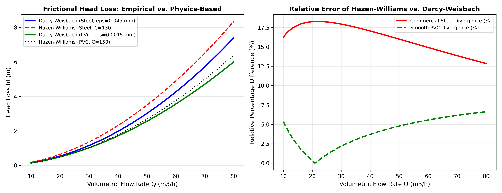

# 1D Pipe Flow Hydraulics: Empirical vs. Physics-Based Modeling

A parametric fluid mechanics study comparing the empirical **Hazen-Williams** correlation against the physics-based **Darcy-Weisbach** formulation (closed via the explicit Swamee-Jain friction factor) across turbulent Reynolds numbers ($Re \approx 6.34 \times 10^4$ to $2.54 \times 10^5$).

## Fluid Mechanics Rationale

* **Hazen-Williams ($h_f = \frac{10.67 L Q^{1.852}}{C^{1.852} d^{4.87}}$):** An empirical curve-fit strictly valid for turbulent water at $\approx 20^\circ\text{C}$. It assumes a constant velocity exponent and neglects kinematic viscosity ($\nu$) and Reynolds number ($Re$) scaling.
* **Darcy-Weisbach ($h_f = f \frac{L}{d} \frac{V^2}{2g}$):** Derived from momentum conservation and dimensional analysis. By dynamically computing the Darcy friction factor $f(Re, \epsilon/d)$, it accurately captures viscous sublayer and relative wall roughness ($\epsilon/d$) effects across any Newtonian fluid.

## Numerical Validation ($L = 100\text{ m}, d = 0.1\text{ m}$, Commercial Steel)

| Flow Rate ($\text{m}^3/\text{h}$) | Reynolds Number ($Re$) | Hazen-Williams $h_f$ (m) | Darcy-Weisbach $h_f$ (m) | Relative Difference |
| :--- | :--- | :--- | :--- | :--- |
| **18** | $6.34 \times 10^4$ | 0.53 | 0.45 | 18.15% |
| **36** | $1.27 \times 10^5$ | 1.90 | 1.62 | 17.43% |
| **54** | $1.90 \times 10^5$ | 4.03 | 3.49 | 15.57% |
| **72** | $2.54 \times 10^5$ | 6.87 | 6.04 | 13.66% |

## Visual Analysis Across Roughness Regimes

