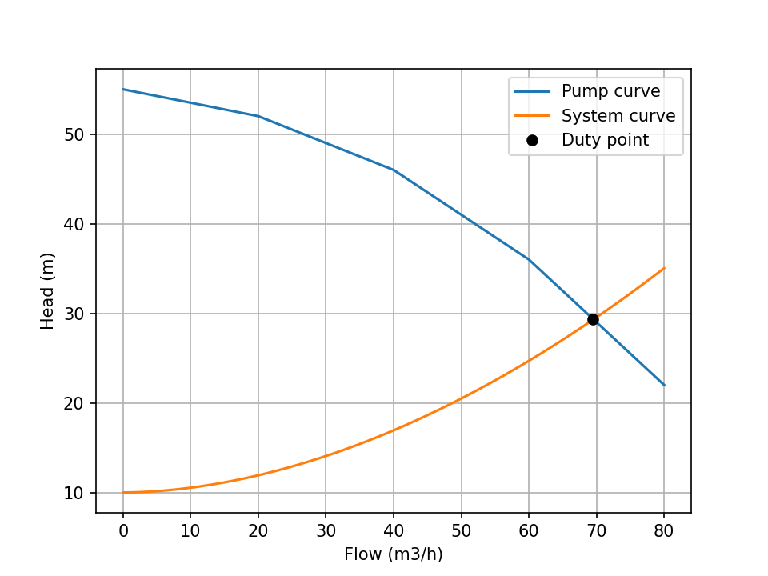

# Pump-System Hydraulic Matching & Duty Point Determination

A computational fluid mechanics script that determines the steady-state operating point (**duty point**) of a centrifugal pump coupled to a pressurized piping network by solving the intersection of the pump performance curve and the system resistance curve.

## Hydraulic Modeling Rationale

* **System Head Curve ($H_{\text{sys}}$):** Represents the total dynamic head required to move fluid through the pipeline at a given volumetric flow rate ($Q$), combining static elevation lift ($H_{\text{static}}$) and frictional head loss ($h_f$) modeled via the Hazen-Williams equation:
  $$H_{\text{sys}}(Q) = H_{\text{static}} + \frac{10.67 L Q^{1.852}}{C^{1.852} d^{4.87}}$$
* **Pump Performance Curve ($H_{\text{pump}}$):** Characterizes the head supplied by the pump across its operating flow range, interpolated linearly across discrete manufacturer datasheet points (`Q_pump`, `H_pump`).
* **Duty Point Intersection:** Evaluated numerically via sign-change detection (`np.diff(np.sign(H_pump - H_sys))`) where supplied pump head equals required system head ($H_{\text{pump}} = H_{\text{sys}}$).

## System Parameters & Operating Output

* **Pipeline Geometry:** $L = 300\text{ m}$, internal diameter $d = 0.1\text{ m}$ ($100\text{ mm}$), roughness coefficient $C = 130$
* **Static Lift ($H_{\text{static}}$):** $10\text{ m}$
* **Flow Evaluation Domain:** $0$ to $80\text{ m}^3/\text{h}$ ($801$ discretized steps)
* **Calculated Duty Point:** **$69.5\text{ m}^3/\text{h}$ at $29.4\text{ m}$ total head**

## Visual Analysis

